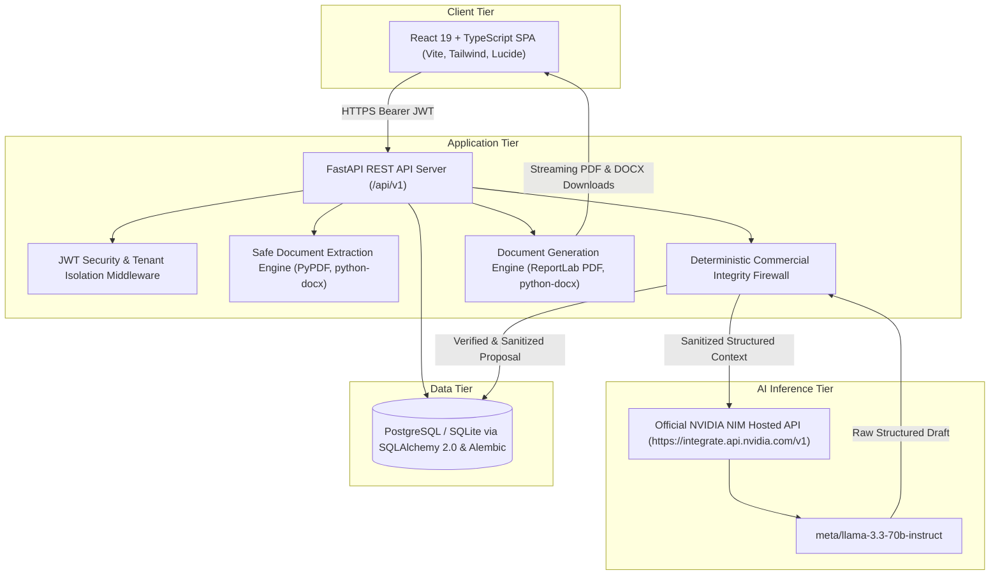

# ProposalCraft AI — Proposal & Scope-of-Work Drafting Assistant
### Enterprise-Grade SOW & Proposal Drafting Powered by NVIDIA NIM Hosted LLMs

[](https://fastapi.tiangolo.com)
[](https://react.dev)
[](https://www.typescriptlang.org)
[](https://build.nvidia.com)
[](LICENSE)
[](backend/tests)

---

## 1. Executive Summary & Product Vision

**ProposalCraft AI** is a full-stack, production-engineered proposal drafting and Statement of Work (SOW) platform designed for IT service providers, technology consultancies, digital agencies, and enterprise business development teams.

It bridges the gap between unstructured client discovery notes and legally enforceable, structured business agreements. By integrating directly with official **NVIDIA NIM hosted inference microservices** (e.g. `meta/llama-3.3-70b-instruct`), it rapidly synthesizes detailed technical scopes, deliverable tables, assumptions, dependencies, risk matrices, and delivery sequencing.

### The Most Critical Business Rule: The Commercial Integrity Firewall
> **THE AI MUST NEVER INVENT PRICING OR COMMERCIAL COMMITMENTS.**

In commercial consulting, an AI fabricating a rate, hallucinating a delivery deadline, or inventing an unauthorized warranty creates catastrophic business risk. ProposalCraft AI guarantees commercial integrity by design:
1. **Zero Price Fabrication**: Prices, fees, hourly rates, currencies, payment schedules, and warranties are **never** generated or estimated by the language model.
2. **Authoritative Structured Injection**: All commercial sections are constructed deterministically by application backend logic strictly from company-authorized, admin-approved **Service Packages**.
3. **Adversarial Safety Scanners**: Non-commercial narrative sections are automatically scanned for unauthorized currency symbols (`$`, `€`, `£`, `₹`), invented discounts, or unapproved guarantees. If detected, they are automatically sanitized and converted into high-priority **Confirmation Questions**.
4. **Honest Missing-Price Fallbacks**: If commercial information has not been configured in a package, the system explicitly states *"Pricing not provided — confirmation required"*, creating an actionable human task rather than substituting a dangerous `$0` or guessing.

---

## 2. System Architecture



---

## 3. Technology Stack

| Layer | Technology | Purpose |
| :--- | :--- | :--- |
| **Frontend** | React 18 / 19, TypeScript, Vite | High-performance, type-safe single page application |
| **Styling** | Tailwind CSS, Lucide Icons | Accessible, responsive, restrained B2B SaaS design system |
| **State & Forms** | TanStack Query, React Hook Form | Server-state caching and client validation |
| **Backend** | Python 3.11, FastAPI, Uvicorn | High-throughput asynchronous REST API (`/api/v1`) |
| **Validation** | Pydantic v2 & Pydantic-Settings | Request/response schemas and LLM structured JSON validation |
| **ORM & DB** | SQLAlchemy 2.0 (Async), Alembic | Tenant-isolated data models and database migrations |
| **Database** | PostgreSQL (Production) / SQLite (Local Dev) | Persistent relational storage with foreign key constraints |
| **AI Inference** | NVIDIA NIM API (`openai` client) | Real model inference hosted at `https://integrate.api.nvidia.com/v1` |
| **PDF Generation** | ReportLab | Pixel-perfect downloadable PDF documents with two-pass canvas |
| **Word Generation**| python-docx | Editable `.docx` documents preserving headers, footers, tables |
| **Testing** | Pytest, pytest-asyncio, Vitest | Unit, integration, and pricing safety adversarial suites |

---

## 4. Key Platform Features

1. **Client & Project Scoping**:
   - Create and manage clients with industry, contact details, and internal notes.
   - Define business problem statements, target outcomes, existing technical environments, and known constraints.
2. **Multi-Source Discovery Notes & Ingestion**:
   - Rich notes editor supporting meeting notes, interview takeaways, and technical requirements.
   - Upload `TXT`, `PDF`, and `DOCX` documents. Safe text extraction with automated defanging of prompt-injection attempts.
3. **Approved Service Package Catalog**:
   - Governance catalog where administrators manage, version, approve, or archive service packages.
   - Stores authoritative structured deliverables, inclusions, exclusions, and commercial terms.
4. **Starter & Custom Proposal Templates**:
   - Standard starter proposal template clearly labeled with branding palettes and section schemas.
5. **Step 7 Pre-Generation Fact Review**:
   - Performs a deterministic audit before calling NVIDIA NIM.
   - Categorizes confirmed facts, package deliverables, client goals, unconfirmed assumptions, and potential contradictions.
   - Computes an objective Proposal Readiness Score (0-100%).
6. **Real NVIDIA NIM Model Inference**:
   - Generates structured proposals via official NVIDIA NIM API (`meta/llama-3.3-70b-instruct`).
   - Exponential backoff retries, rate-limit handling, request timeouts, and Pydantic schema validation.
7. **Proposal Editing Workspace**:
   - Full section-by-section markdown editor.
   - Debounced autosave with optimistic concurrency version locking to prevent concurrent overwrite.
   - Section-by-section regeneration with custom instructions while preserving approved sections.
   - Snapshot creation, version history listing, and 1-click version restoration.
8. **Missing-Information & Confirmation Center**:
   - Dedicated panel tracking open confirmation questions with rationale, impact, and role assignment.
   - Commercial questions block final proposal approval until resolved by an authorized stakeholder.
9. **Executive Document Exports**:
   - **Download PDF**: Formatted ReportLab document with custom navy styling, deliverables tables, metadata headers, and page numbering ("Page X of Y").
   - **Download DOCX**: Fully editable Microsoft Word document preserving paragraph headings, tables, and confidential footers.
10. **Role-Based Tenant Isolation**:
    - Multi-tenant architecture ensuring non-admin consultants only access their own clients, projects, and proposals.

---

## 5. Local Quickstart (macOS Apple Silicon & Linux)

### Prerequisites
- Python 3.11+
- Node.js 18+ & npm
- Git

### 1. Clone the Repository
```bash
git clone https://github.com/your-username/proposalcraft-ai.git
cd proposalcraft-ai
```

### 2. Configure Environment Variables
Copy `.env.example` to `.env`:
```bash
cp .env.example .env
```
Fill in your configuration:
```ini
APP_ENV=development
DATABASE_URL=sqlite+aiosqlite:///./proposalcraft.db
JWT_SECRET_KEY=your-secure-32-character-secret-key
NVIDIA_API_KEY=nvapi-your-real-key-from-build.nvidia.com
NVIDIA_BASE_URL=https://integrate.api.nvidia.com/v1
NVIDIA_MODEL=meta/llama-3.3-70b-instruct
FRONTEND_URL=http://localhost:5173
BACKEND_PUBLIC_URL=http://localhost:8000
```

### 3. Setup Backend
```bash
python3 -m venv backend/.venv
source backend/.venv/bin/activate
pip install -r backend/requirements.txt
```

### 4. Setup Frontend
```bash
cd frontend
npm install
cd ..
```

### 5. Run the Application
In terminal 1 (Backend API):
```bash
source backend/.venv/bin/activate
python3 -m uvicorn backend.app.main:app --host 0.0.0.0 --port 8000 --reload
```
*The database automatically creates all tables and seeds starter templates, sample approved packages, and initial accounts.*

In terminal 2 (Frontend SPA):
```bash
cd frontend
npm run dev
```

Open your browser to `http://localhost:5173`.

### Quick Demo Logins:
- **Lead Consultant**: `consultant@proposalcraft.ai` / `Consultant12345!`
- **System Administrator**: `admin@proposalcraft.ai` / `Admin12345!`

---

## 6. How to Obtain an NVIDIA API Key

1. Visit [NVIDIA Build](https://build.nvidia.com/) and register or sign in with your NVIDIA Developer account.
2. Select any hosted language model from the catalog (e.g. **Llama 3.3 70B Instruct** or **Mistral Large 2**).
3. Click **Get API Key** and generate an API key (starts with `nvapi-`).
4. Set `NVIDIA_API_KEY=nvapi-...` in your `.env` file.
5. In ProposalCraft AI, navigate to **Settings & Status** and click **Test Connectivity** to verify live connection to NVIDIA NIM.

---

## 7. Running the Automated Test Suite

### Run Backend Pytest Suite
```bash
source backend/.venv/bin/activate
cd backend
PYTHONPATH=.. pytest -v tests/
```
Output:
```text
tests/test_auth.py::test_user_registration PASSED
tests/test_auth.py::test_duplicate_registration_fails PASSED
tests/test_auth.py::test_user_login_success PASSED
tests/test_auth.py::test_user_login_invalid_password PASSED
tests/test_auth.py::test_protected_me_endpoint PASSED
tests/test_auth.py::test_unauthorized_access_rejected PASSED
tests/test_clients_projects.py::test_client_crud_and_isolation PASSED
tests/test_clients_projects.py::test_project_crud_and_isolation PASSED
tests/test_commercial_guardrail.py::test_missing_pricing_does_not_invent_zero_or_free PASSED
tests/test_commercial_guardrail.py::test_model_invented_discount_and_price_sanitized PASSED
tests/test_commercial_guardrail.py::test_currency_fabrication_flagged PASSED
tests/test_commercial_guardrail.py::test_prompt_injection_sanitization PASSED
tests/test_exports.py::test_pdf_export_structure PASSED
tests/test_exports.py::test_docx_export_structure PASSED
tests/test_nvidia_service.py::test_nvidia_client_missing_key_reports_status PASSED
tests/test_nvidia_service.py::test_nvidia_chat_completion_mock_success PASSED
tests/test_nvidia_service.py::test_nvidia_rate_limit_retry PASSED
tests/test_proposals.py::test_proposal_lifecycle_and_optimistic_locking PASSED

======================= 18 passed in 9.58s =======================
```

### Run Frontend Vitest Suite
```bash
cd frontend
npm run test:run
```
Output:
```text
 ✓ src/tests/Badge.test.tsx (3)
 Test Files  1 passed (1)
      Tests  3 passed (3)
```

---

## 8. Docker & Production Deployment

For full cloud deployment instructions on Render, Railway, AWS, and Vercel, see [docs/deployment.md](docs/deployment.md).

To run locally with Docker Compose:
```bash
docker compose up -d --build
```
- Frontend: `http://localhost:5173`
- Backend API & Interactive Docs: `http://localhost:8000/docs`
- PostgreSQL: `localhost:5432`

---

## 9. Known Limitations & Roadmap

- **OCR for Scanned PDFs**: Document ingestion currently extracts machine-readable selectable text from PDFs via `pypdf`. Image-only/scanned PDFs display a clear OCR advisory.
- **Custom Branding Assets**: Custom logo image rendering in templates is supported through URL/base64 embedding; image asset storage integration with AWS S3 / Cloudflare R2 is planned for v1.1.
- **Organization Workspaces**: Current architecture enforces user-level tenant isolation; team-wide shared organization access controls are mapped for subsequent releases.

---

## 10. License

This project is licensed under the MIT License — see the [LICENSE](LICENSE) file for details.
