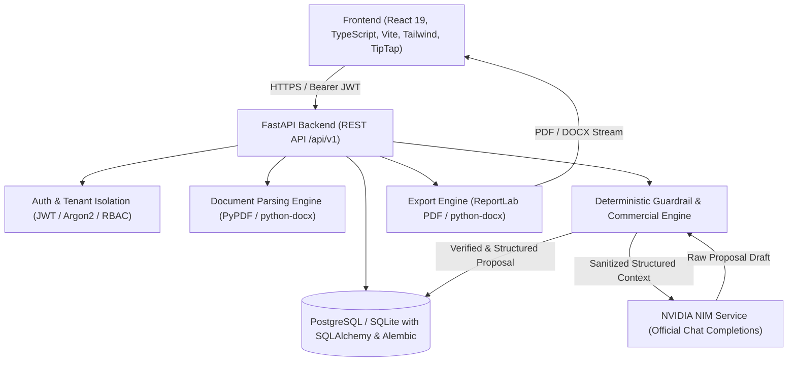
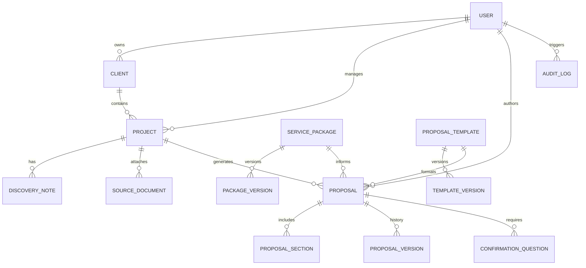

# ProposalCraft AI — System Architecture & Specification

## 1. Executive Overview
ProposalCraft AI is an enterprise-grade proposal and Statement of Work (SOW) drafting assistant. It leverages high-performance LLMs hosted on **NVIDIA NIM** (such as `meta/llama-3.3-70b-instruct`) while enforcing **deterministic commercial safeguards**: AI models draft scope, deliverables, assumptions, risks, and client responsibilities, but **never invent pricing, payment terms, delivery dates, or contractual warranties**.

## 2. High-Level Architecture Diagram

## 3. Data Models & Entity Relationships

## 4. Key Entities Detail

1. **User**: `id`, `email`, `hashed_password`, `full_name`, `role` (`admin`, `consultant`, `reviewer`), `is_active`, `created_at`.
2. **Client**: `id`, `owner_id`, `company_name`, `primary_contact_name`, `contact_email`, `industry`, `website`, `background`, `internal_notes`, `created_at`, `updated_at`.
3. **Project**: `id`, `owner_id`, `client_id`, `title`, `project_type`, `business_problem`, `desired_outcomes`, `existing_environment`, `constraints`, `required_integrations`, `delivery_approach`, `target_dates`, `status` (`intake`, `in_review`, `proposal_ready`, `archived`).
4. **DiscoveryNote**: `id`, `project_id`, `content`, `note_type` (`meeting_notes`, `interview`, `requirements`, `constraints`), `created_at`.
5. **SourceDocument**: `id`, `project_id`, `original_filename`, `storage_path`, `file_type` (`txt`, `pdf`, `docx`), `file_size_bytes`, `extracted_text`, `sanitized_text`, `uploaded_at`.
6. **ServicePackage**: `id`, `name`, `slug`, `category`, `description`, `intended_use`, `deliverables` (JSON), `included_activities` (JSON), `excluded_activities` (JSON), `dependencies` (JSON), `constraints` (JSON), `approval_status` (`draft`, `approved`, `archived`), `current_version`, `approved_by_id`, `approved_at`.
   - Structured Commercial Terms: `pricing_model` (`fixed_fee`, `time_and_materials`, `retainer`, `unspecified`), `currency` (e.g. `USD`, `INR`), `fixed_fee_amount`, `hourly_rate`, `payment_schedule`, `commercial_terms`.
7. **ProposalTemplate**: `id`, `name`, `description`, `is_default`, `approval_status`, `branding` (JSON), `sections_schema` (JSON: order, title, required, protected_legal_text), `created_at`.
8. **Proposal**: `id`, `project_id`, `owner_id`, `package_id`, `template_id`, `title`, `status` (`draft`, `in_review`, `approved`, `archived`), `current_version_number`, `generation_metadata` (JSON: model used, token count, latency, review warnings), `created_at`, `updated_at`.
9. **ProposalSection**: `id`, `proposal_id`, `section_key`, `title`, `content_markdown`, `content_html`, `sort_order`, `is_protected`, `source_references` (JSON), `last_modified_by`.
10. **ProposalVersion**: `id`, `proposal_id`, `version_number`, `snapshot_json`, `change_summary`, `created_at`, `created_by_id`.
11. **ConfirmationQuestion**: `id`, `proposal_id`, `question`, `category` (`pricing`, `timeline`, `scope`, `technical`, `dependency`), `rationale`, `impact`, `status` (`open`, `answered`, `resolved`, `dismissed`), `answer`, `resolved_by_id`, `resolved_at`.
12. **AuditLog**: `id`, `user_id`, `action`, `resource_type`, `resource_id`, `details` (JSON), `ip_address`, `timestamp`.

## 5. The Commercial Integrity Firewall

1. **Extraction**: Structured price fields reside in `ServicePackage`.
2. **Prompt Boundary**: The system prompt instructs the NVIDIA NIM LLM to NEVER fabricate numbers or currencies.
3. **Deterministic Synthesis**: In `proposal_generation.py`, the commercial section is composed programmatically from trusted database values.
4. **Adversarial Validation**: A regex & semantic scanner inspects all generated content. Any unapproved currency symbols, rate figures, or unauthorized deadline claims are stripped or flagged as critical review questions.
5. **No Blind Fallbacks**: If commercial details are missing, the UI and document output state: `"Pricing not provided — confirmation required."` Never `0` or free.

